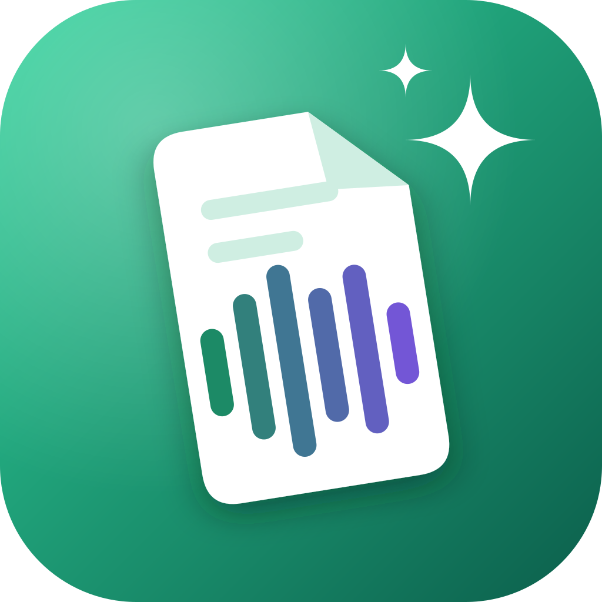
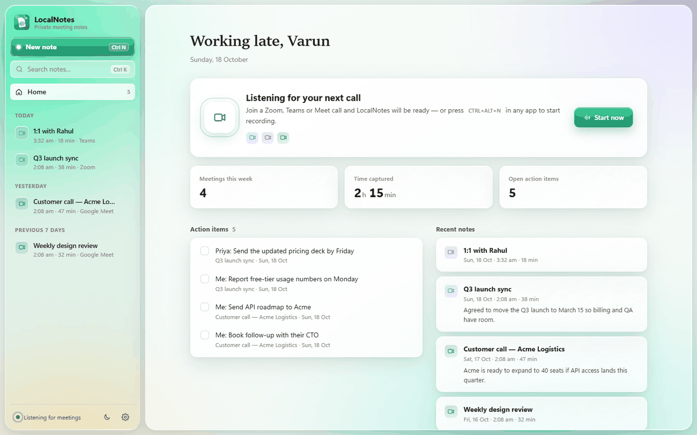
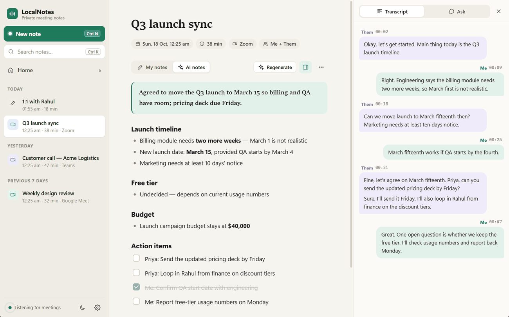
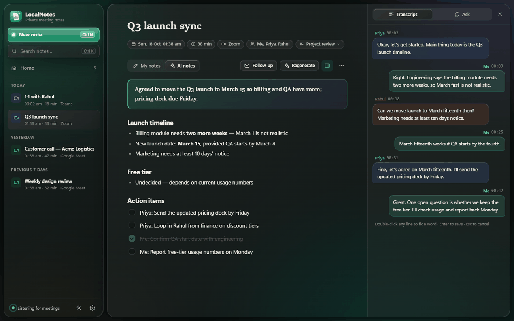
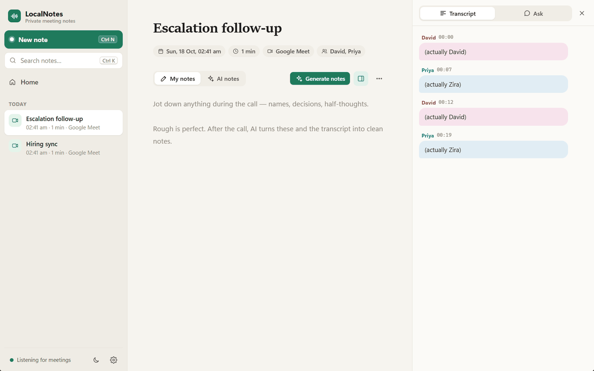
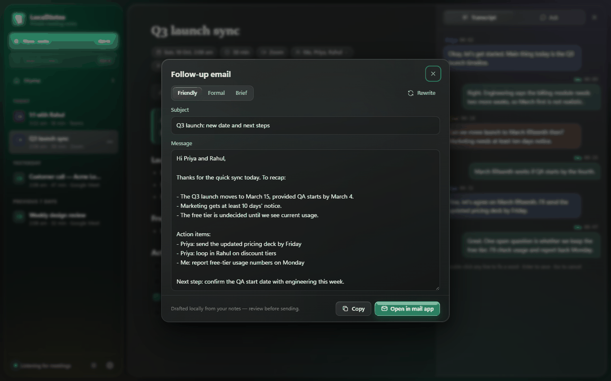

<p align="center"></p>

<h1 align="center">LocalNotes</h1>

<p align="center"><b>Private AI meeting notes that never leave your PC.</b></p>

LocalNotes records your calls, transcribes them, recognises who's speaking, and turns your rough notes into clean,
structured meeting notes — entirely on your own Windows machine. No accounts, no cloud, no bots joining your meetings.



## Features

- **Works with any call app** — Zoom, Microsoft Teams, Google Meet, Webex, Slack and Discord. LocalNotes notices
  when a call starts and offers to take notes through a small floating widget.
- **Two-sided recording** — your microphone (“Me”) and your computer's audio (“Them”) are captured separately,
  so the transcript always knows which side spoke.
- **Live transcript** with [faster-whisper](https://github.com/SYSTRAN/faster-whisper), then an **after-call accuracy
  pass** with Whisper large-v3-turbo that replaces the draft.
- **Speaker recognition with voice profiles** — voices are separated after each call. Tag someone once
  (“Speaker 2 → Priya”) and they're named automatically in every future meeting.
- **AI notes from a local model** via [Ollama](https://ollama.com). Your rough notes are the backbone; the
  transcript fills in the details, decisions and action items.
- **Templates** — General, 1:1, Customer call, Standup, Interview, Project review, Brainstorm, Lecture — picked
  automatically from the meeting title, or write your own.
- **Ask your meeting** — “What did we decide?”, “What are my action items?”
- **Follow-up emails** drafted in your choice of tone, ready to open in your mail app.
- **Editable transcript** — fix a misheard word; LocalNotes offers to remember it in your custom vocabulary.
- **Pause / resume** to take part of a call off the record.
- **Global hotkeys** — `Ctrl+Alt+N` starts or stops recording from any app, `Ctrl+Alt+P` pauses.
- **Encrypted at rest** — notes, transcripts and voice profiles are stored in an AES-256 encrypted database whose key
  is protected by your Windows account.
- Searchable history, action items across all meetings, light and dark themes, and a command palette (`Ctrl+K`).

| Meeting notes | Dark mode |
|---|---|
|  |  |
| **Speaker recognition** | **Follow-up email** |
|  |  |

## Requirements

- Windows 10 or 11 (64-bit)
- 16 GB RAM recommended (8 GB works with smaller models)
- About 5 GB of disk for the speech and AI models
- Python 3.12 and [Ollama](https://ollama.com) — the setup script installs both if they're missing

No GPU is needed; everything runs on the CPU.

## Install

```powershell
git clone https://github.com/varunmundhada/localnotes.git
cd localnotes
powershell -ExecutionPolicy Bypass -File .\setup.ps1
```

The script creates a virtual environment, installs the Python packages, downloads the speaker and speech models,
installs Ollama with the `llama3.2:3b` model, adds Start Menu and desktop shortcuts, and finishes with a self-check.
It is safe to run again at any time — for example after pulling updates.

Options: `-NoShortcuts`, `-SkipOllama`, `-SkipSpeechModels`.

To check an existing install: `.venv\Scripts\python.exe selfcheck.py`

## Usage

1. **Join a call.** LocalNotes offers to take notes — or press **New note** / `Ctrl+Alt+N`.
2. **Jot rough notes** in *My notes* while you talk. A few words per point is enough.
3. **Stop the recording** (or just hang up — it stops when the call ends). Notes appear within about a minute,
   and are rewritten once the accuracy pass finishes.
4. **Click a speaker's name** in the transcript to tag them; LocalNotes remembers their voice from then on.

Closing the window keeps LocalNotes running in the system tray so it can keep listening for calls.
Right-click the tray icon to quit.

> **Please record responsibly.** Only record people who know they're being recorded, and follow the laws and
> workplace policies that apply to you.

## Privacy

- Audio, transcripts, notes and voice profiles stay on your PC. The only network traffic is downloading models
  during setup (and the first time a model is used).
- Data lives in `%APPDATA%\LocalNotes`. The database is encrypted with SQLCipher (AES-256); its key is stored in
  `storage.key`, encrypted with Windows DPAPI so it only works for your Windows account.
- Call audio is kept only while it's being processed, unless you turn on *Keep call audio* in Settings.

See [SECURITY.md](SECURITY.md) for details.

## How it works

```
mic ──┐                       ┌─ live transcript (Whisper base.en)
      ├─ WASAPI capture ──────┤
loopback ┘   16 kHz chunks    └─ saved tracks ─► speaker separation (sherpa-onnx)
                                              ─► accuracy pass (Whisper large-v3-turbo)
                                              ─► notes / Ask / follow-ups (Ollama, local LLM)
```

[docs/ARCHITECTURE.md](docs/ARCHITECTURE.md) walks through the modules and the post-call pipeline.

## Development

```powershell
.venv\Scripts\python.exe app.py                 # run from source
$env:LOCALNOTES_DATA = "$env:TEMP\ln-dev"        # use a throwaway data folder instead of your real notes
$env:LOCALNOTES_DEBUG = "1"                       # enable the WebView developer tools
```

See [CONTRIBUTING.md](CONTRIBUTING.md) for the workflow, and [CHANGELOG.md](CHANGELOG.md) for what's changed.

## Acknowledgements

Built on [faster-whisper](https://github.com/SYSTRAN/faster-whisper), [sherpa-onnx](https://github.com/k2-fsa/sherpa-onnx),
[Ollama](https://ollama.com), [pywebview](https://pywebview.flowrl.com/), [SQLCipher](https://www.zetetic.net/sqlcipher/)
and [PyAudioWPatch](https://github.com/s0d3s/PyAudioWPatch). Model licences are listed in
[THIRD_PARTY_NOTICES.md](THIRD_PARTY_NOTICES.md).

## License

[MIT](LICENSE) © 2026 Varun Mundhada
