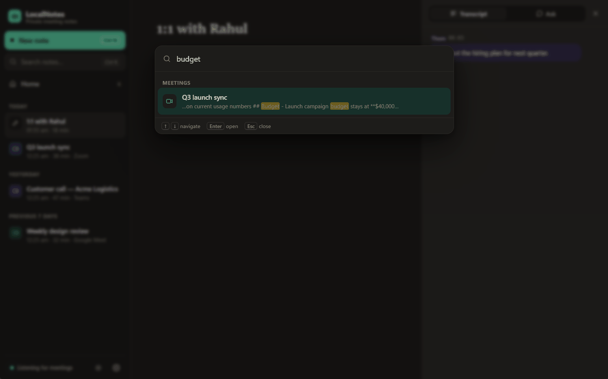

<p align="center"></p>

<h1 align="center">LocalNotes</h1>

<p align="center"><b>Private AI meeting notes for Windows, without a bot in your calls.</b></p>

LocalNotes records your calls, transcribes them, recognises who's speaking, and turns your rough notes into clean,
structured meeting notes. Recordings, notes and voice profiles are stored only on your PC, encrypted. The heavy AI
work runs on [Groq](https://groq.com)'s free tier by default, so the laptop stays light, or entirely on your own
machine if you prefer. No accounts, no bots joining your meetings.


## Features

- **Works with any call app** — Zoom, Microsoft Teams, Google Meet, Webex, Slack and Discord. LocalNotes notices
  when a call starts and offers to take notes through a small floating widget.
- **Two-sided recording** — your microphone (“Me”) and your computer's audio (“Them”) are captured separately,
  so the transcript always knows which side spoke.
- **Live transcript** with Whisper large-v3 on Groq (or [faster-whisper](https://github.com/SYSTRAN/faster-whisper)
  on your CPU, followed by an after-call accuracy pass with large-v3-turbo).
- **Works offline** — with no internet, recording carries on and the audio is kept. The missed transcript and the notes
  are finished automatically as soon as you're back online, even after a restart.
- **Speaker recognition with voice profiles** — voices are separated after each call. Tag someone once
  (“Speaker 2 → Priya”) and they're named automatically in every future meeting.
- **English, Hindi and Hinglish meetings** — set a language per meeting (or a default). In the cloud, Hindi words
  are transcribed in Devanagari; on-device, Hinglish uses
  [Oriserve's Whisper-Hindi2Hinglish](https://huggingface.co/Oriserve/Whisper-Hindi2Hinglish-Apex) models, which
  write it in Roman script. Notes can be written in English, Hindi or Hinglish regardless of the meeting's language.
- **AI notes** from Qwen 3.8 27B on Groq (or GPT-OSS 120B / 20B), or a local model via [Ollama](https://ollama.com).
  Your rough notes are the backbone; the transcript fills in the details, decisions and action items.
- **Templates** — General, 1:1, Customer call, Standup, Interview, Project review, Brainstorm, Lecture — picked
  automatically from the meeting title, or write your own.
- **Ask your meeting** — “What did we decide?”, “What are my action items?”
- **Follow-up emails** drafted in your choice of tone, ready to open in your mail app.
- **Editable transcript** — fix a misheard word; LocalNotes offers to remember it in your custom vocabulary.
- **Pause / resume** to take part of a call off the record.
- **Global hotkeys** — `Ctrl+Alt+N` starts or stops recording from any app, `Ctrl+Alt+P` pauses.
- **Encrypted at rest** — notes, transcripts and voice profiles are stored in an AES-256 encrypted database whose key
  is protected by your Windows account.
- A frosted-glass interface over a soft aurora (or a flat “Classic” style), light and dark themes, searchable
  history, action items across all meetings, and a command palette (`Ctrl+K`).

| Meeting notes with named speakers | Dark mode |
|---|---|
|  |  |
| **Search everything** | **Follow-up email** |
|  |  |

## Requirements

- Windows 10 or 11 (64-bit)
- Python 3.12 — the setup script installs it if it's missing
- A free [Groq API key](https://console.groq.com/keys) (cloud engine, the default)

For the on-device engine instead: 16 GB RAM recommended, about 6 GB of disk for the models, and
[Ollama](https://ollama.com) (installed by `setup.ps1 -Local`). No GPU is needed either way.

## Install

```powershell
git clone https://github.com/varunmundhada/localnotes.git
cd localnotes
powershell -ExecutionPolicy Bypass -File .\setup.ps1
```

The script creates a virtual environment, installs the Python packages, downloads the small speaker-recognition
models (45 MB), adds Start Menu and desktop shortcuts, and finishes with a self-check. It is safe to run again at any
time — for example after pulling updates.

Then open LocalNotes → **Settings → Cloud AI** and paste your Groq API key. It's checked straight away and stored
encrypted with your Windows account.

Options: `-NoShortcuts`, and `-Local` to also install the on-device engine (Whisper and Hinglish speech models,
Ollama with `qwen3:4b-instruct`, ~5 GB; skip parts of it with `-SkipOllama`, `-SkipSpeechModels`, `-SkipHinglish`).

To check an existing install: `.venv\Scripts\python.exe selfcheck.py`

## Usage

1. **Join a call.** LocalNotes offers to take notes — or press **New note** / `Ctrl+Alt+N`.
2. **Jot rough notes** in *My notes* while you talk. A few words per point is enough.
3. **Stop the recording** (or just hang up — it stops when the call ends). Notes appear within seconds in the
   cloud (on-device: about a minute, rewritten once the accuracy pass finishes).
4. **Click a speaker's name** in the transcript to tag them; LocalNotes remembers their voice from then on.

Closing the window keeps LocalNotes running in the system tray so it can keep listening for calls.
Right-click the tray icon to quit.

> **Please record responsibly.** Only record people who know they're being recorded, and follow the laws and
> workplace policies that apply to you.

## Privacy

- Recordings, transcripts, notes and voice profiles are stored only on your PC. LocalNotes has no server.
- **Cloud engine (default):** to transcribe and write notes, audio chunks and transcripts are sent to Groq over HTTPS.
  Groq says it doesn't use API data to train models. Speaker recognition always runs on your PC. Choose
  *Settings → Cloud AI → This PC only* to keep everything on the machine.
- **On-device engine:** nothing is sent anywhere; the only network traffic is downloading models.
- Data lives in `%APPDATA%\LocalNotes`. The database is encrypted with SQLCipher (AES-256); its key is stored in
  `storage.key`, encrypted with Windows DPAPI so it only works for your Windows account.
- Call audio is kept only while it's being processed (or until the cloud is reachable again), unless you turn on
  *Keep call audio* in Settings. The Groq API key is stored DPAPI-encrypted in `groq.key`.

See [SECURITY.md](SECURITY.md) for details.

## How it works

```
mic ──┐                       ┌─ live transcript (Groq Whisper large-v3; offline: queued)
      ├─ WASAPI capture ──────┤
loopback ┘   10–30 s chunks   └─ saved tracks ─► speaker separation (sherpa-onnx, on this PC)
                                              ─► missed stretches transcribed once online
                                              ─► notes / Ask / follow-ups (Groq: Qwen 3.8 27B)
```

On-device engine: faster-whisper base.en live, a large-v3-turbo accuracy pass after the call, and Ollama for notes.

[docs/ARCHITECTURE.md](docs/ARCHITECTURE.md) walks through the modules and the post-call pipeline.

## Development

```powershell
.venv\Scripts\python.exe app.py                 # run from source
$env:LOCALNOTES_DATA = "$env:TEMP\ln-dev"        # use a throwaway data folder instead of your real notes
$env:LOCALNOTES_DEBUG = "1"                       # enable the WebView developer tools
```

See [CONTRIBUTING.md](CONTRIBUTING.md) for the workflow, and [CHANGELOG.md](CHANGELOG.md) for what's changed.

## Acknowledgements

Built on [Groq](https://groq.com), [faster-whisper](https://github.com/SYSTRAN/faster-whisper), [sherpa-onnx](https://github.com/k2-fsa/sherpa-onnx),
[Ollama](https://ollama.com), [pywebview](https://pywebview.flowrl.com/), [SQLCipher](https://www.zetetic.net/sqlcipher/)
and [PyAudioWPatch](https://github.com/s0d3s/PyAudioWPatch). Model licences are listed in
[THIRD_PARTY_NOTICES.md](THIRD_PARTY_NOTICES.md).

## License

[MIT](LICENSE) © 2026 Varun Mundhada
